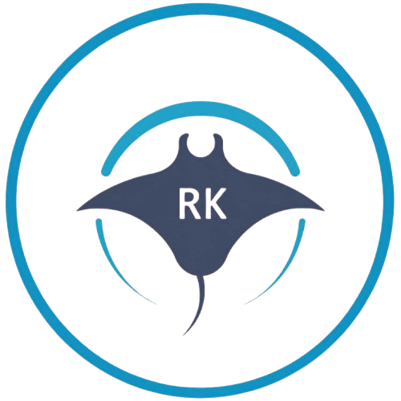

  

<h1 align="center">RKREEF · Mořská akvária RK</h1>

  Mořská akvária na míru – návrh, výroba, montáž a servis po celé ČR. 
  <a href="https://rkreef.eu">rkreef.eu</a> · +420 735 548 756

---

## Co děláme

### Mořská akvária na míru
Navrhneme, vyrobíme, dovezeme, zapojíme a předáme živé, zaběhnuté akvárium – od nano setů po velké útesové systémy s prouděním, které odpovídá přírodnímu útesu.
- **Vlastní konstrukce:** skříňky (zátěžově testované paletou cihel Porotherm), sumpy, reverzní osmóza a přepady vyvíjíme a vyrábíme sami.
- **Instalace po celé ČR** i v Německu, Polsku a na Slovensku.
- **Podklady pro zákazníka:** vizualizace, nabídka s rozpisem techniky a smlouva o dílo.

### Vlastní přepadový systém – užitný vzor č. 38266
Přepad z 3D tisku, který jsme vyvinuli sami a který je chráněný **užitným vzorem č. 38266** (zapsán 26. 11. 2024). Na vlastní LED osvětlení RK LIGHT jsme podali **přihlášku vynálezu PV 2026-277**.

### Servis akvárií
Jezdíme přímo k zákazníkům po celé ČR. Servisujeme mořská i sladkovodní akvária – i ta, která jsme nestavěli.
- **Měření parametrů na místě:** salinita, teplota, pH, KH, vápník, hořčík, dusičnany a fosforečnany.
- **Laboratorní ICP rozbor vody**, který odhalí i stopové prvky a kontaminace.
- **Kontrola techniky:** odpěňovač, čerpadla a proudění, osvětlení, dolévání, dávkování, osmóza a filtrace.
- **Stav ryb, korálů a bezobratlých:** kondice, nemoci a paraziti, zbarvení korálů.
- **Poradenství a konkrétní plán dalších kroků** – žádné obecné rady do prázdna.

### Havárie 24/7 a záchranná stanice
Praskne nádrž, vypadne technika, stěhujete se nebo přestavujete systém? Havárie řešíme **nonstop** a živočichy dočasně převezmeme do našich nádrží, kde se o ně postaráme.

### Edukace a kurzy
- **Kurzy jeden na jednoho** přes video hovor, vždy zaměřené na vaše konkrétní akvárium, v ČR i v zahraničí.
- **Čtyři úrovně (3, 6, 9 a 12 měsíců):** od základů a chemismu vody přes stabilní systémy, světlo, choroby a karanténu až po pokročilou chemii, mikroprvky a symbiózu.
- **Komunita** Mořská akvaristika pro všechny CZ/SK s více než 1 300 členy, komunitní fórum na webu a vzdělávací videa na sítích.

### E-shop
Technika, chemie, ICP testy a vybavení pro mořskou akvaristiku: [rkreef.eu/eshop](https://rkreef.eu/eshop/)

### Vlastní díly z 3D tisku
Držáky techniky, přepady, koše na filtrační média a další díly, které se nedají koupit, navrhujeme a tiskneme sami.

## O mně

### Radek Kraus, MBA
**Founder & CEO RKREEF · Lead Developer & Hardware Architect · Founder RK Studio**

Stojím v čele RKREEF – od strategie a vývoje produktů přes výrobu až po realizace u zákazníků. Spojuji tři světy: **business, technologie a mořskou biologii**.

- **Vize:** mořská akvaristika dostupná pro všechny – bez statisíců za techniku a bez nutnosti být chemik. Proto budujeme vlastní ekosystém výrobků, aplikací a služeb pod jednou značkou.
- **Vlastní cesta:** RKREEF jsem vybudoval od nuly, doma „na koleni“, bez kopírování komerčních značek – vlastní jméno, vlastní kvalita, vlastní technologie. Za sebou mám užitný vzor a přihlášku vynálezu.
- **Leadership vývoje:** řídím celý vývoj RKREEF – elektroniku, firmware, mobilní a desktopové aplikace, cloud i e-shop – a sám ho architektonicky navrhuji.
- **Realizace v Česku i v zahraničí:** akvária navrhujeme, stavíme a servisujeme v Česku, Německu, Polsku a na Slovensku – od nano setů po útesové systémy s více než 600 litry.
- **Komunita:** založil jsem komunitu **Mořská akvaristika pro všechny CZ/SK**, která má přes 1 300 členů. Vlastní odchov klaunů očkatých.
- **Odbornost:** chemie mořské vody, biologie korálového útesu a soužití organismů – akvária mě provázejí od dětství, mořské se naplno věnuji od roku 2020.
- **Manažerské zázemí:** **MBA – Digital Marketing** (IT academy Prague, mezinárodní akreditace IES London a International Certification Institute, 2026) – řízení organizace a projektů, obchodní a marketingová strategie, leadership a komunikace. Předtím kariéra v IT, mimo jiné jako **IT manažer**.
- **RK Studio:** pod touto značkou dodávám firmám řešení na klíč – e-shopy, rezervační systémy, mobilní aplikace a IoT – a pomáhám jim zbavit se drahých pronajatých platforem.

## Vlastní výrobky

Elektroniku, konstrukci, firmware i aplikace vyvíjíme sami. Zdrojový kód je soukromý.

### RK LIGHT – LED osvětlení mořského akvária
Hardware, firmware, aplikace i cloud jsou náš vlastní vývoj. Podali jsme přihlášku vynálezu PV 2026-277.
- **Spektrum pro korály:** nezávisle nastavitelné barevné kanály – royal blue, blue, UV/violet, bílá, zelená a červená.
- **Plynulé stmívání bez viditelného blikání** a velmi jemné nastavení jasu, takže přechody jsou pro oko i korály neznatelné.
- **Denní program** s vlastní křivkou pro každou barvu, východ a západ slunce, astronomický měsíční cyklus, efekty mraků a bouřky.
- **Aklimatizace korálů:** vícedenní postupné navyšování světla po výměně svítidla nebo nasazení nových korálů.
- **Ochrana:** hlídání teploty s řízeným chlazením a postupným snížením výkonu při přehřátí.
- **Spolehlivost:** svítí podle programu samo, i bez aplikace a internetu. Nastavení Wi-Fi přes Bluetooth, aktualizace na dálku.
- **Ovládání:** doma napřímo přes místní síť (rychle a bez internetu), mimo domov přes cloud – přepíná se automaticky.
- **Připravujeme RK LIGHT nové generace:** kompaktní výkonné světlo pro menší akvária, které jde řadit vedle sebe a ovládá se stejnou aplikací.

### RK Control System – řídicí a měřicí jednotka akvária
Ve vývoji, první deska jde do výroby. Kompletně vlastní vývoj: elektronika, firmware i aplikace.
- **Měření:** pH, ORP, salinita, teplota a hladina vody (pro automatické dolívání nebo hlídání úniku vody).
- **Přesné a stabilní hodnoty:** měřicí část je navržená tak, aby sondy nerušila čerpadla ani další technika v akváriu.
- **Řízení:** proudová čerpadla s vlnovými režimy a krmnou pauzou na jedno stisknutí, stmívání světel.
- **Kalibrace sond s průvodcem:** hodnota se uloží až po ustálení sondy, automatická teplotní kompenzace.
- **Samostatný provoz:** jednotka měří a řídí sama, i bez internetu a bez aplikace, a čas drží i po výpadku proudu.
- **Bezpečné aktualizace** s automatickým návratem k předchozí verzi při chybě; po výpadku se jednotka sama vzpamatuje.
- **Plán:** propojení s RK LIGHT, upozornění na mobil při odchylce hodnot, dávkování a chytré zásuvky.

### RK Rollermat Nano – automatický fleece filtr
Ve vývoji. Vlastní konstrukce pro 3D tisk, řídicí elektronika i firmware.
- Fleece se posouvá **samo podle skutečného zanesení** (hlídá hladinu vody), ne podle časovače – role vydrží déle.
- Pohon drží fleece pevně i bez proudu, umí couvnout a pozná zaseknutí.
- Upozorní na konec role nebo poruchu, role se mění rychle a bez nářadí.
- Navržený pro naše akvárium **Nano 100**, uvnitř zadní technické komory.

### RKREEF Nano 100 – kompletní AIO akvárium
Ve vývoji. Mořské akvárium „vše v jednom“ pro začátečníky i do kanceláře.
- Nádrž se skříňkou a víkem, technika ukrytá v zadních komorách: filtrace, odpěňovač, filtrační média a lapač bublin.
- Vlastní výrobní výkresy dílů, díly z CNC i 3D tisku, připravené pro RK Rollermat a RK LIGHT.

## Aplikace

### RK Reef Control – mobilní aplikace (Android)
**Vydaná na Google Play** od 21. 11. 2026 ve 27 zemích EU: [RK Reef Control na Google Play](https://play.google.com/store/apps/details?id=eu.morskaakvaria.reef)
- Průvodce prvním spuštěním, přihlášení a obnova dat z cloudu.
- Ovládání jednoho světla i celého akvária naráz, editor spektra a denního programu.
- Programy dávkování, plán údržby, sdílení programů přes QR, zálohy v cloudu.
- Upozornění, když světlo vypadne nebo je potřeba údržba.

### RKREEF Control – aplikace pro Windows a tablet u akvária
Řídí a hlídá akvárium s jednotkou Neptune Apex a světly RK LIGHT.
- **Přehled:** pH, salinita, ORP, teplota a příkon, barevný stav podle nastavených rozsahů, grafy a trendy.
- **Technika:** ovládání zásuvek, krmný režim, karty světel se spektrem.
- **Spotřeba energie** v kWh i v korunách, odhad na měsíc a rozpad na topení, čerpadla a světla.
- **Osvětlení:** editor programu pro světla AI i RK LIGHT včetně předvoleb aklimatizace.
- **Testy vody, údržba a historie** s týdenním souhrnem do PDF, upozornění ve Windows, čeština i angličtina.
- Verze pro tablet slouží jako stálý panel přímo u akvária.

### Akvárium v chytré domácnosti
Napojení akvária do Home Assistant: hodnoty vody, světla a spotřeba přímo v přehledu domácnosti.

## Programování a vývoj

Všechno od elektroniky po cloud programujeme sami. Zdrojový kód je soukromý, tady je přehled, co a v čem děláme.

- **Firmware (C/C++, PlatformIO):** řízení světel a měřicí jednotky v reálném čase, denní programy a efekty, kalibrace sond, nastavení Wi-Fi přes Bluetooth LE, místní API v domácí síti, napojení na cloud, aktualizace na dálku (OTA) s digitálním podpisem a automatickým návratem k předchozí verzi, hlídání chodu a bezpečný režim.
- **Mobilní aplikace (Flutter, Dart):** párování zařízení přes Bluetooth, ovládání přes místní síť i cloud s automatickým přepínáním, editory spektra a programů, sdílení přes QR, notifikace, přihlášení a zálohy v cloudu. Vydávání přes Google Play.
- **Cloud (Firebase):** přihlášení uživatelů, databáze Firestore a Realtime Database, Cloud Functions (Node.js), úložiště a bezpečnostní pravidla, relay pro ovládání zařízení mimo domov.
- **Desktop (Python):** aplikace pro Windows s webovým rozhraním, komunikace s Neptune Apex přes REST API, měření spotřeby, grafy, PDF reporty, instalátor.
- **Web a e-shop (HTML, JavaScript, Node.js):** vlastní pokladna a zákaznické účty, napojení dopravců DPD, PPL a Zásilkovna, synchronizace skladu a cen s dodavateli, automatické faktury, generování produktových feedů a sitemap.
- **Zakázkový vývoj (TypeScript, React, Next.js, Payload CMS, PostgreSQL, Docker):** e-shopy a rezervační systémy bez měsíčních poplatků a provizí, migrace z pronajatých platforem, platby kartou i QR.
- **Návrh hardwaru a výroby:** návrh desek plošných spojů v KiCad včetně podkladů pro strojní osazení, parametrické 3D modely v OpenSCAD s automatickou kontrolou kolizí, simulace řízení, výrobní výkresy pro CNC, rendery v Blenderu a 3D tisk.
- **Automatizace a AI:** skripty pro výrobu podkladů, tiskové archy, zpracování fotek a videí, práce s AI asistenty při vývoji.

## Web a e-shop rkreef.eu

- Prezentační web, e-shop s vlastní pokladnou a zákaznickým účtem.
- Doprava DPD a PPL, automatická synchronizace skladu a cen s dodavateli, faktury a administrace objednávek.
- Věrnostní program, konfigurátor akvária, komunitní fórum a stránka ke stažení aplikace.

## Videa a sítě

Natáčíme vlastní spoty a videa z realizací, stavby akvárií a péče o korály – sledujte nás na Instagramu, TikToku, Facebooku a YouTube (odkazy níže).

## Další projekty

Weby a e-shopy, které jsme postavili od návrhu po spuštění:
- **Svíčky PS** – web a e-shop ručně odlévaných svíček z přírodních vosků, včetně etiket a kartiček do balení.
- **PikaCards** – e-shop se sběratelskými kartami.

## Technologie

  
  
  
  
  
  
  
  
  
  
  
  
  
  

## Kontakt

| | |
|---|---|
| Web | [rkreef.eu](https://rkreef.eu) · [rkstudio.cz](https://rkstudio.cz) |
| Telefon | +420 735 548 756 |
| E-mail | radekkrs@gmail.com |
| Instagram | [@morska_akvaria_rk](https://www.instagram.com/morska_akvaria_rk/) |
| TikTok | [@rkreef](https://www.tiktok.com/@rkreef) |
| Facebook | [Mořská akvária RK](https://www.facebook.com/profile.php?id=100016105538040) |
| YouTube | [@Morska-Akvaria](https://www.youtube.com/@Morska-Akvaria) |

Radek Kraus · IČO 19068085 · Šimonovice u Liberce
